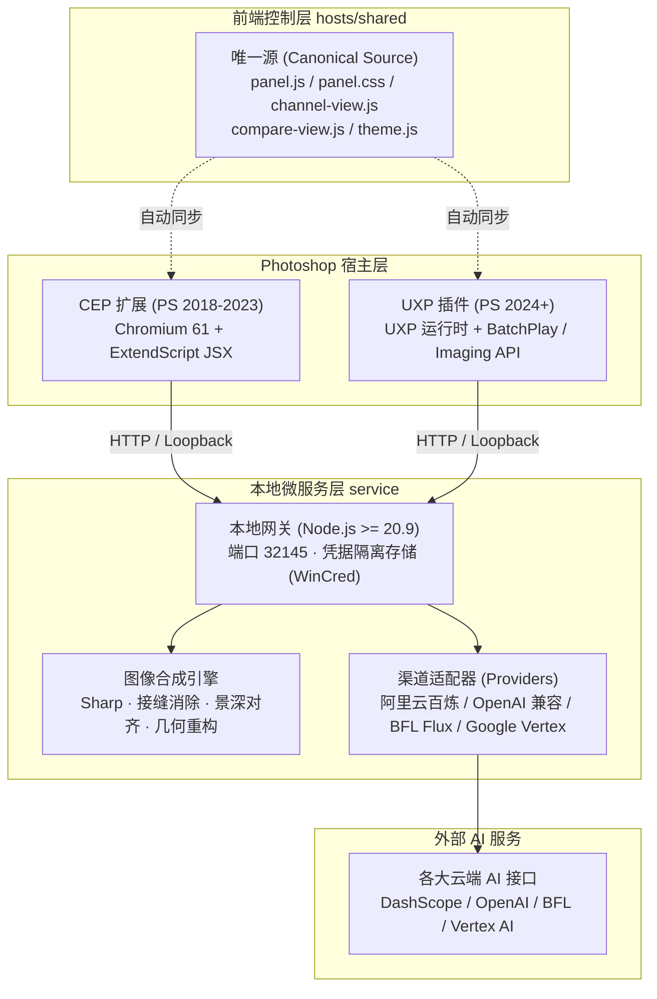

# AI 图像工坊 · 二次开发指南

> 本文档面向计划在本仓库上进行**功能扩展、新增模型渠道、UI 改造、算法调优或集成新工作流**的开发者。
> 动手前请务必通读本指南与根目录的 [`AGENTS.md`](../AGENTS.md)。

---

## 目录

1. [架构全景与目录职责](#1-架构全景与目录职责)
2. [二次开发核心铁律（不可协商）](#2-二次开发核心铁律不可协商)
3. [快速起步与工作流命令](#3-快速起步与工作流命令)
4. [本地调试环境搭建](#4-本地调试环境搭建)
5. [实战场景一：接入新的 AI 模型/服务商 (Provider)](#5-实战场景一接入新的-ai-模型服务商-provider)
6. [实战场景二：新增/修改面板 UI 控件](#6-实战场景二新增修改面板-ui-控件)
7. [实战场景三：图像扩图与合成算法二次开发](#7-实战场景三图像扩图与合成算法二次开发)
8. [实战场景四：Photoshop 宿主层通信扩展](#8-实战场景四photoshop-宿主层通信扩展)
9. [测试体系、构建打包与交付检查清单](#9-测试体系构建打包与交付检查清单)

---

## 1. 架构全景与目录职责

本项目是一个面向 Windows Photoshop 的混合架构插件，兼顾旧版（2018–2023，基于 CEP/Chromium 61）与现代版（2024+，基于 UXP），通过本地轻量 Node.js 微服务作为统一网关连接各大 AI 模型与图像合成引擎。



### 核心目录职责划分

| 路径 | 角色与职责 | 开发注意事项 |
|---|---|---|
| `hosts/shared/` | **前端逻辑与样式的唯一源**。包含控制器、CSS 样式、渠道视图、大图对比、主题切换。 | **切勿直接改动 CEP/UXP 下的副本**；修改此处后运行 `npm run sync`。 |
| `hosts/cep/` | Photoshop CEP 宿主端代码。包含 `manifest.xml`、`jsx/bridge.jsx` (ExtendScript) 以及从 `shared` 复制的前端文件。 | 运行在旧版 Chromium 61 内核，严禁现代 CSS 语法。 |
| `hosts/uxp/` | Photoshop UXP 宿主端代码。包含 `manifest.json`、`imaging-adapter.js`、`photoshop-host.js` 及从 `shared` 复制的前端文件。 | 运行在 UXP 独立容器内，遵循 Adobe UXP 规范。 |
| `service/` | 本地微服务。负责凭据存取、任务排队、探针连通测试、图像几何与拼缝合成（Sharp）、多 Provider 转发。 | Node.js 原生代码，零冗余依赖（仅 `sharp`）。通过 Windows 凭据管理器加密保存 API Key。 |
| `preview/` | 纯浏览器端调试环境。包含 `live.html`（可交互的 Mock 界面）与 `ui-template.html`（活文档 UI 规范示例）。 | 无需打开 Photoshop 即可调试 90% 的前端交互与排版。 |
| `docs/` | 架构与样式规范。`ui-style-guide.md`（UI 样式宪法）、`ui-template/skeleton.html`（DOM 结构骨架）。 | 改界面必须同步维护规范文档。 |
| `release/` | 构建与打包脚本。支持生成 CEP 安装包、UXP 加载包、便携绿色版 (`studio/`)。 | 使用 PowerShell 编写，带语法与完整性断言。 |

---

## 2. 二次开发核心铁律（不可协商）

在开始编写代码前，必须牢记以下四条底线规则：

1. **唯一源与逐字节副本机制**：
   - `hosts/shared/` 下的 5 个文件是前端的**唯一源头**：
     - `panel.js`
     - `panel.css`
     - `channel-view.js`
     - `compare-view.js`
     - `theme.js`
   - `hosts/cep/` 和 `hosts/uxp/` 里的同名文件是**逐字节副本**。每次修改 `hosts/shared/` 后，**必须运行 `npm run sync`**。`hosts/cep/test/panel-parity.test.js` 会在测试时逐字节核对，分叉会导致测试直接红灯。
2. **暗房仪器视觉规范（单一彩色）**：
   - 全界面**仅允许一种彩色**：琥珀强调色 `--accent` 以及语义状态色（`--ok` / `--warn` / `--err`）。禁止引入任何其他色彩（避免修图时干扰画面的色温中性判断）。
   - 层次严格依赖灰阶与 1px 细线，不使用投影、浮层阴影、卡片渐变。
   - 所有动态变化的数字必须使用等宽字体（`font-variant-numeric: tabular-nums`），刷新时严禁左右跳动抖动。
3. **Chromium 61 兼容红线**：
   - CEP 端运行于 Chromium 61。**绝对禁止**使用以下 CSS 特性：
     - ❌ `flex` 的 `gap` 属性
     - ❌ `:has`、`:is`、`:where` 选择器
     - ❌ `clamp()`、裸 `min()` / `max()`
     - ❌ `conic-gradient`、`accent-color`
     - ❌ `aspect-ratio`
     - ❌ `inset: 0`（必须写 `top: 0; right: 0; bottom: 0; left: 0;`）
   - `hosts/cep/test/ui-guard.test.js` 会静态扫描所有 CSS，违规语法会被立即拦截。
4. **跨端几何真值与图层约定**：
   - **`canvasBounds` 是几何真值**：扩图时由 Photoshop 宿主上报真实图层边界；Alpha 通道反推仅为兜底。
   - **结果图必须是画布尺寸，且只有新增区有像素**：扩图结果以独立图层贴回画布，原图层像素绝不被覆盖篡改。

---

## 3. 快速起步与工作流命令

项目根目录已配置标准 `package.json`，提供统一的开发与验证脚本：

| 命令 | 作用 | 适用时机 |
|---|---|---|
| `npm run sync` | 自动将 `hosts/shared/` 同步至 CEP 与 UXP 副本目录 | 改动任何 shared 文件后 |
| `npm run sync:check` | 仅检查副本与唯一源是否一致，不写入 | CI 或提交前自检 |
| `npm test` | 执行全量测试（hosts 测试 143 项 + service 测试 223 项） | 核心逻辑改动后 |
| `npm run test:hosts` | 仅执行 CEP/UXP 宿主逻辑、Parity 校验及 UI Guard 测试（1 秒内完成） | UI/前端快速迭代时 |
| `npm run test:service`| 仅执行本地 Node.js 服务的单元与端到端测试 | 修改 service / provider 时 |
| `npm run start:service`| 启动本地微服务（端口 32145） | 联调测试或真实使用时 |
| `npm run verify` | 一键运行：同步检查 + hosts 测试 + 打包完整性验证 | 日常开发最推荐的快速自检 |
| `npm run verify:all` | 运行：同步检查 + 全量测试 (hosts + service) + 打包验证 | 准备提交代码时 |
| `npm run build` | 制作免安装绿色便携完整包（位于 `dist/studio`） | 交付或打包发布时 |

---

## 4. 本地调试环境搭建

### 方案 A：纯浏览器端热调试（无需 Photoshop，推荐用于 90% 的 UI 开发）

1. 直接用任意现代浏览器打开：
   - `preview/live.html`：包含完整的面板交互模拟器，内置了 Photoshop 选区模拟、底图预览、生成状态模拟。
   - `preview/ui-template.html`：UI 组件全景看板（色板、字号阶梯、按钮、表单、提示行活文档）。
2. 在 `hosts/shared/panel.js` 或 `hosts/shared/panel.css` 中调整代码。
3. 运行 `npm run sync`，刷新浏览器页面即可立即看到效果。

### 方案 B：本地服务独立调试

```bash
# 1. 进入 service 目录（首次拉取代码或换机器后先确认依赖）
cd service
npm ci

# 2. 启动服务（显示本地连接码并监听 32145 端口）
node src/main.js
```

服务提供了几个非常实用的独立排查脚本：
- `node scripts/probe-provider.js`：无需面板，直接从命令行测试指定 API 渠道的连通性与模型支持度。
- `node scripts/start-openai.js`：从 `service/openai.env` 快速读取环境变量配置启动测试。

### 方案 C：Photoshop 实机联调

- **旧版 Photoshop (2018–2023，CEP)**：
  1. 开启调试模式：在注册表 `HKEY_CURRENT_USER\Software\Adobe\CSXS.<Version>` 下将 `PlayerDebugMode` 设为 `1`。
  2. 运行 `./release/install-dev-cep.ps1 -CsxsVersion <8|9|10|11>` 安装开发软链。
  3. 打开 Chrome，访问 `http://localhost:8088`（端口在 `hosts/cep/.debug` 中配置）即可使用 Chrome DevTools 实时调试面板 DOM 与 JavaScript。
- **现代版 Photoshop (2024+，UXP)**：
  1. 打开 **Adobe UXP Developer Tool**。
  2. 点击 **Add Plugin**，选择 `dist/uxp/org.studio.aiimg.uxp/manifest.json` 或 `hosts/uxp/manifest.json`。
  3. 点击 **Load** 加载到正在运行的 Photoshop 中。
  4. 点击 **Debug** 即可调出 UXP DevTools 查看 Elements、Console 与 Network。

---

## 5. 实战场景一：接入新的 AI 模型/服务商 (Provider)

接入新 Provider（例如接入 Claude、Midjourney Proxy、Replicate、或私有自建 SD/ComfyUI 服务）的标准链路如下：

### 第 1 步：创建 Provider 适配器文件

在 `service/src/providers/` 目录下新建 `my-provider.js`。适配器必须实现以下基础接口契约：

```javascript
// service/src/providers/my-provider.js

/**
 * 探针测试：验证 Key、地址连通性与模型可用性
 */
async function probeChannel({ baseUrl, apiKey, model }) {
  // 必须只验证网络连通与鉴权，绝不要产生计费出图
  // 返回格式：{ ok: boolean, message: string, timings?: object, verifiedModels?: string[] }
}

/**
 * 提交任务：支持文生图 (text-to-image)、选区重绘 (masked-edit)、扩图 (expand)
 */
async function submitTask(task) {
  // task 包含：
  // task.mode: 'text-to-image' | 'masked-edit' | 'expand'
  // task.prompt: 提示词
  // task.image: 经过几何处理的输入图片（Buffer/Base64）
  // task.mask: 遮罩图像（如有）
  // task.canvasBounds / expandScales: 扩图几何参数
  // task.requestedSize: { width, height }
  //
  // 返回任务 ID 或直接返回完成状态：
  // { status: 'SUCCEEDED' | 'PENDING', taskId: '...', resultUrls: [...] }
}

/**
 * 轮询任务状态（若云端接口为异步提交模式）
 */
async function pollTask(taskId, credentials) {
  // 返回：{ status: 'PENDING' | 'SUCCEEDED' | 'FAILED', resultUrls: [...], progress?: number }
}

module.exports = {
  probeChannel,
  submitTask,
  pollTask,
};
```

### 第 2 步：在核心分发与存储层注册

1. **`service/src/channel-store.js`**：
   - 在支持的渠道类型清单中增加你的渠道类型标识（如 `'my-provider'`）。
   - 在默认配置与序列化/反序列化逻辑中添加该渠道特有字段的白名单（注意：API Key 必须走 `credential-store.js` 加密，不得存盘为明文 JSON）。
2. **`service/src/channel-probe.js`**：
   - 将你的 `probeChannel` 挂载到统一探针路由分发中。
3. **`service/src/jobs.js`**：
   - 在任务提交分支中，根据当前激活的渠道调用你的 `submitTask` 与 `pollTask`。

### 第 3 步：编写单元测试（必须驱动开发）

在 `service/test/my-provider.test.js` 中编写测试：
- 测试地址归一化（用户输入带不带 `/v1`、末尾斜杠的处理）。
- 测试 401（Key 错误）、403、404、网络超时等错误的分流报告，文案必须对用户友好。
- 测试异步任务结果下载与 PNG 标准化。
- 运行 `npm run test:service` 确保全部测试通过。

### 第 4 步：在前端设置中暴露配置选项

1. 修改 `hosts/shared/channel-view.js`：
   - 在渠道选择下拉框或标签页中增加选项。
   - 增加该渠道专属的字段绑定（如服务地址、预设模型列表、尺寸模式映射）。
2. 运行 `npm run sync` 同步至两端。

---

## 6. 实战场景二：新增/修改面板 UI 控件

界面的修改必须严格遵循 `docs/ui-style-guide.md`，走标准化流程：

### 决策树：新控件落位规则

```
想加一个控件？
  │
  ├─ 1. 是一个新的「做什么」？
  │     └─> 增加一个 .mode 单选分段项
  │
  ├─ 2. 是每次生成都要看一眼的短参数？
  │     └─> 放入 .param-row（一行 2~3 项，标签在上，常显）
  │
  ├─ 3. 是带约束/进阶微调选项？
  │     └─> 放入 .advanced-fields（高级折叠区，默认收起）
  │
  ├─ 4. 是配置、Key、服务状态？
  │     └─> 放入设置抽屉页对应的 .group 中
  │
  └─ 5. 是操作结果展示？
        └─> 放入 .previews 候选卡片区，或复用 .status 状态提示行
```

### 标准实施步骤

1. **同步修改 4 个 HTML 文件的 DOM 结构**：
   保持结构和控件 ID 绝对一致：
   - `docs/ui-template/skeleton.html`（规范骨架）
   - `hosts/cep/index.html`（CEP 端）
   - `hosts/uxp/index.html`（UXP 端）
   - `preview/live.html`（浏览器预览器）
   > `hosts/cep/test/ui-guard.test.js` 会对比骨架与两端 HTML 的 ID 集合，漏改任一处会报错。
2. **在 `hosts/shared/panel.css` 中编写样式**：
   - 必须使用现有的 `--token` 颜色变量，严禁出现裸色值（如 `#fff`、`rgb(...)`）。
   - 字号严格限制在规范阶梯内：`10 / 11 / 11.5 / 12 / 12.5 / 13 / 14` px。
   - 圆角严格限制在规范阶梯内：`0 / 1 / 2 / 3 / 4 / 6 / 8 / 10` px 或 `50%`。
   - 严禁使用 Chromium 61 黑名单语法（见第 2 节）。
3. **在 `hosts/shared/panel.js` 中编写事件逻辑**。
4. **一键同步与检验**：
   ```bash
   npm run sync
   npm run test:hosts
   ```
   测试会自动校验：
   - 样式是否存在 Chromium 61 不支持的语法。
   - 字号、圆角、颜色 token 是否越界。
   - 两端与 preview 的 DOM ID 是否完全对齐。
   - 副本与唯一源是否逐字节一致。

---

## 7. 实战场景三：图像扩图与合成算法二次开发

图像扩图是本项目最精密的模块，核心实现位于：
- `service/src/expand-compose.js`：图像几何重构、接缝消除、景深模糊补偿、二维补偿场
- `service/src/expand-prompt.js`：智能扩图提示词组装策略
- `service/src/image-inspection.js`：Alpha 透明区反推与图层几何校验

### 扩图核心算法机制备忘

1. **单边延伸比例控制**：
   - 经验上单边延伸比例推荐控制在 **$\le 15\%$**。过大（$>20\%$）容易引发模型对被切断物体的幻觉与整幅重构。
2. **形态自动退避（Fidelity Scoring）**：
   - 扩图不仅依赖单一指令，系统内置了对回图的四道保真度判定（`extensionFidelity`）：
     - 是否原样返回？
     - 是否全白/全黑？
     - 扩展区细节能量是否不足？
     - **原图区域是否发生漂移（大于 10 灰阶视为模型私自重绘了整幅画面）**。
   - 当带遮罩重绘失败时，系统会自动退避至留白底稿形态或 `bare` 纯扩展形态。
3. **接缝平滑与色偏补偿**：
   - 采样点必须越过羽化带（`2 * feather + 16`）采样生成区本色，避免软亮带。
   - 带有兜底平滑机制（`enforceSeamContinuity`）：即使色延展失败，也能按中位数拉平两侧 1~4px 的微小色阶差。

---

## 8. 实战场景四：Photoshop 宿主层通信扩展

如果需要调用 Photoshop 的新功能（如读取蒙版通道、导出选区路径、操作图层样式等）：

### CEP 侧 (ExtendScript / JSX)
- 脚本位于 `hosts/cep/jsx/bridge.jsx`。
- 通过 ExtendScript 访问 Photoshop DOM 对象（`app.activeDocument`、`app.executeAction` 等）。
- 前端通过 `hosts/cep/js/host.js` 内的 `csInterface.evalScript` 发起调用，返回结果统一经过 JSON 序列化。

### UXP 侧 (BatchPlay & Imaging API)
- 脚本位于 `hosts/uxp/src/photoshop-host.js` 与 `imaging-adapter.js`。
- 采用现代异步的 `require('photoshop').action.batchPlay` 协议。
- 像素数据直接通过 `require('photoshop').imaging` 内存 Buffer 高性能读取与回填，无需生成磁盘中间临时文件。

---

## 9. 测试体系、构建打包与交付检查清单

### 三级自动化测试防线

```bash
# 1. 静态与宿主测试 (1s，包含 UI Guard、Parity 检查、几何算法)
npm run test:hosts

# 2. 服务端与集成测试 (~38s，包含各 Provider 真实模拟、Sharp 图像合成、凭据加密)
npm run test:service

# 3. 打包完整性与语法验证
powershell -File ./release/verify-packages.ps1
```

### 交付自检清单 (Checklist)

在提交任何二次开发代码或发布版本前，请逐条勾选：

- [ ] 已在 `hosts/shared/` 维护唯一源，并运行 `npm run sync` 同步所有副本
- [ ] `npm run sync:check` 验证通过，无任何副本分叉
- [ ] `npm run test:hosts` 通过，`ui-guard` 无任何语法、色值或字号违规警告
- [ ] `service` 对应的新增/修改逻辑已有配套单元测试，且 `npm run test:service` 通过
- [ ] 若修改了界面，已在 280px 窄宽度下检查过无横向滚动条，且所有数字保持等宽
- [ ] 键盘 Tab 焦点走通，`:focus-visible` 使用规范的 inset 阴影，无多余残影
- [ ] 运行 `npm run verify`，确认产物语法与打包配置完整合规
- [ ] 若改动了界面结构或新增核心机制，已同步更新 `docs/ui-style-guide.md` 与本指南
